<p align="center">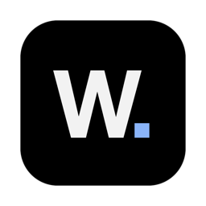</p>

<h1 align="center">Write.</h1>

<p align="center"><b>A dark, distraction-free document editor for your Mac that works like Google Docs — even offline.</b><br>
Free to use. Powered by Formula0ne.</p>

<p align="center"><a href="https://github.com/subhodeep2002/Write/releases/latest"><b>⬇ Download Write. for Mac</b></a> · <a href="https://subhodeep2002.github.io/Write/">Website</a> · <a href="https://subhodeep2002.github.io/Write/privacy.html">Privacy</a></p>

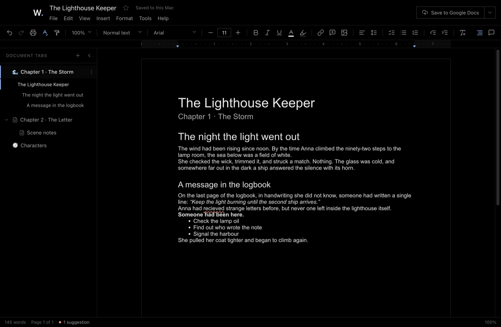

---

## Contents

1. [What is Write.?](#what-is-write)
2. [What you need](#what-you-need)
3. [Download and install](#download-and-install)
4. [Opening it for the first time](#opening-it-for-the-first-time)
5. [Your first document](#your-first-document)
6. [What it can do](#what-it-can-do)
7. [Google Docs sync (optional)](#google-docs-sync-optional)
8. [Where are my files?](#where-are-my-files)
9. [Updating and uninstalling](#updating-and-uninstalling)
10. [Problems and fixes](#problems-and-fixes)
11. [Licence and copyright](#licence-and-copyright)

---

## What is Write.?

Write. is a writing app for macOS. It looks and works like Google Docs, with the same menus, toolbar, pages and document tabs, in a pure black design.

- **Works without internet.** Everything is saved on your Mac automatically, as you type.
- **Feels like Google Docs.** It has headings, fonts, colours, lists, tables, images, comments, page setup, find & replace and version history.
- **Document tabs**, like Google Docs. You can have one tab per chapter, with subtabs and emoji icons.
- **Spelling and grammar checking** that works on your Mac, with no internet needed.
- **Optional Google Docs sync.** Bring your Google Docs in, and send your changes back.

---

## What you need

- A Mac with **Apple Silicon**: M1, M2, M3, M4 or newer. (Not sure? Click  → **About This Mac** and look for "Chip".)
- **macOS 12 (Monterey) or newer.**
- About **400 MB** of free space.

Macs with an Intel processor aren't supported yet.

---

## Download and install

**Step 1 — Download.**
Go to the **[Releases page](https://github.com/subhodeep2002/Write/releases/latest)**. Under **Assets**, click the file named **`Write-1.1.1-arm64.dmg`**. It's about 140 MB and goes into your **Downloads** folder.

**Step 2 — Open the file.**
Double-click **`Write-1.1.1-arm64.dmg`** in Downloads. A window like this appears:

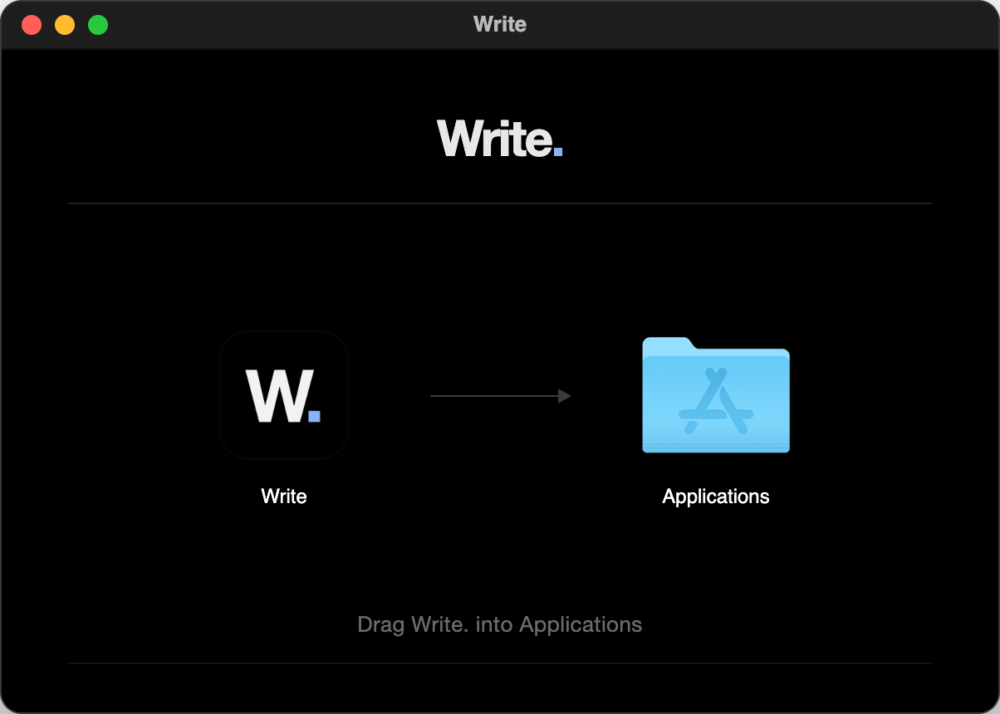

**Step 3 — Drag Write. into Applications.**
Drag the **Write.** icon on the left onto the **Applications** folder on the right. Wait a few seconds while it copies.

**Step 4 — Eject the installer.**
In a Finder window, look at the left sidebar. Click the **⏏** button next to **Write**. You can now delete the `.dmg` file from Downloads.

**Step 5 — Open Write.**
Open your **Applications** folder and double-click **Write**. Or press **⌘ Space**, type **Write**, and press **Return**.

> 💡 To keep it in your Dock, open Write., then right-click its Dock icon and choose **Options → Keep in Dock**.

---

## Opening it for the first time

Write. is a free app, and it isn't registered with Apple's paid developer programme. So the **first time** you open it, macOS asks you to confirm that you trust it. You only do this once.

1. Open Write. macOS shows a message saying it can't check the app for malware. Click **Done**. Don't click "Move to Trash".
2. Open **System Settings** ( → **System Settings…**) and click **Privacy & Security** in the sidebar.
3. Scroll down to the **Security** section. You'll see *"Write." was blocked to protect your Mac*. Click **Open Anyway**.
4. Type your Mac password (or use Touch ID), then click **Open Anyway** once more.

That's it. From now on, Write. opens normally.

<details>
<summary>For advanced users: a Terminal shortcut that does the same thing</summary>

```bash
xattr -dr com.apple.quarantine /Applications/Write.app
```

</details>

---

## Your first document

When Write. opens, you see your documents.

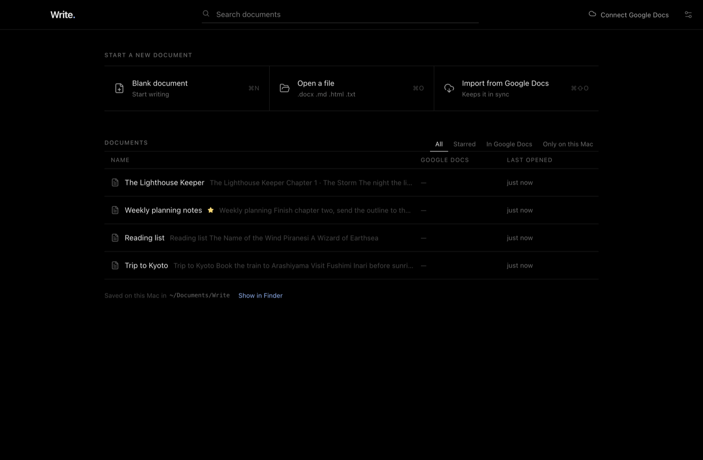

- Click **Blank document** (or press **⌘ N**) to start writing.
- Click **Open a file** to open a Word (`.docx`), Markdown (`.md`), web page (`.html`) or text (`.txt`) file. You can also drag the file onto the window.
- **There's no Save button.** Every change is saved automatically. The top of the window says **"Saved to this Mac"**.
- Click the **W.** in the top-left corner to go back to all your documents.

---

## What it can do

### Document tabs

Split a long document into tabs, like Google Docs. You can use one tab per chapter, add subtabs, and give tabs emoji icons. The headings of the tab you're in are listed under it. Click **+** to add a tab. Click a tab's **⋮** button to rename, duplicate, move or delete it. You can also drag tabs to reorder them.

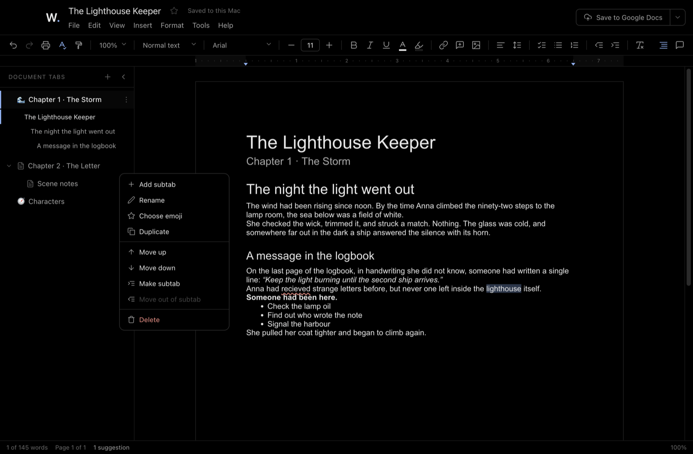

### Spelling and grammar

Mistakes are underlined while you write: **red** for spelling, **blue** for grammar. Click an underlined word to see suggestions, then click one to fix it. **Add to dictionary** remembers names and words you made up. Press **⌥ ⌘ X** to jump to the next mistake. The checking happens on your Mac; nothing is sent anywhere.

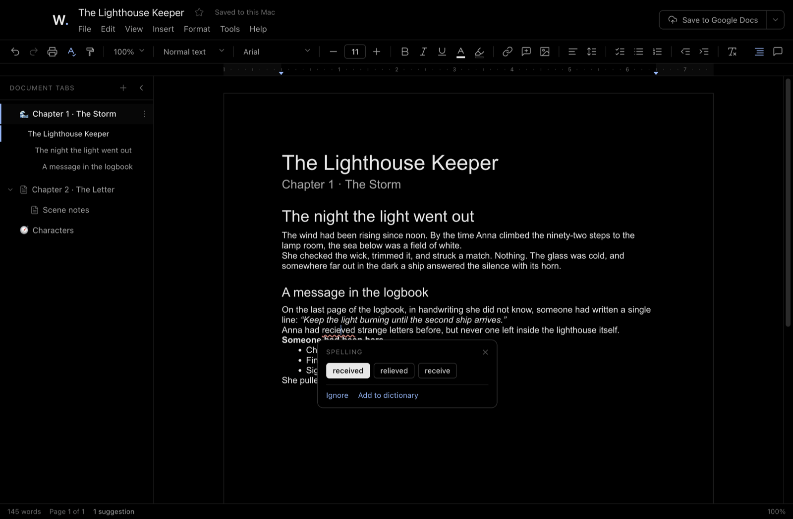

### Right-click menu

Right-click any text for quick formatting, colours, alignment, links, comments, change case and more. Inside a table you can add or remove rows and columns, or **sort the table A → Z**.

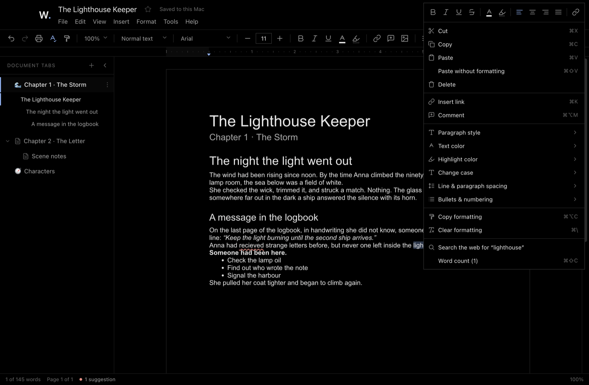

### Download as Word, PDF and more

Go to **File → Download** to save as Word (`.docx`), PDF, web page, Markdown or plain text. If your document has tabs, Write. asks whether you want the **current tab** or **all tabs** in one file.

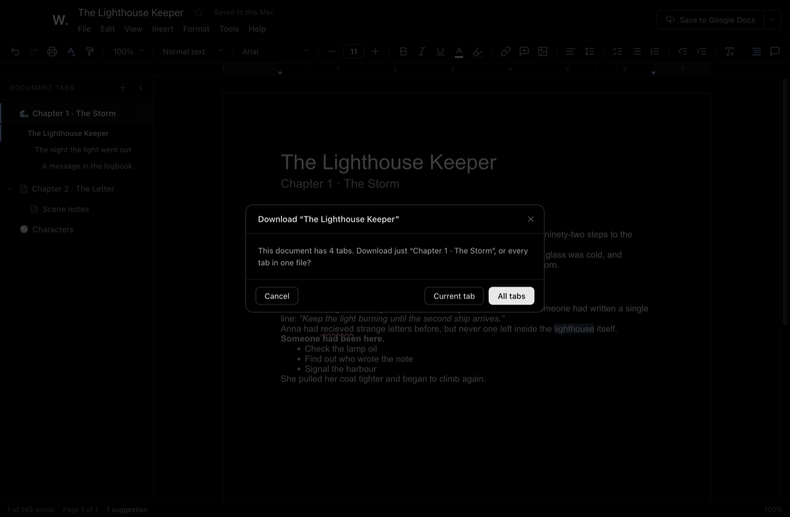

### Version history

Write. keeps earlier versions of your document automatically. Open **File → Version history** to look at an old version and restore it.

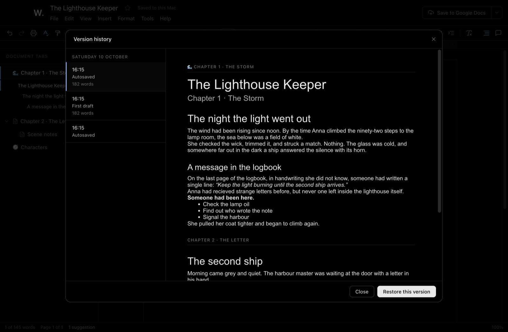

### Everything else

- Paragraph styles (Title, Subtitle, Headings 1–6), fonts and font sizes, bold, italic, underline, colours and highlights.
- Bulleted lists, numbered lists and checklists; tables; images (drag the corners to resize); links; horizontal lines; page breaks.
- Real pages with a ruler, or **Pageless** mode. **File → Page setup** sets Letter, A4 or Legal paper, portrait or landscape, and the margins.
- Comments with replies, find & replace, word count, zoom, a document outline, and a white **Paper preview**.
- Markdown shortcuts as you type: `#` + space for a heading, `-` + space for a bullet, `1.` + space for a numbered list.
- Press **⌘ /** to see all keyboard shortcuts.

---

## Google Docs sync (optional)

**You don't need a Google account to use Write.** Skip this section if you only want to write on your Mac.

### Connect your Google account (once)

1. In Write., open **Settings** (press **⌘ ,**) and click **Sign in with Google**.

   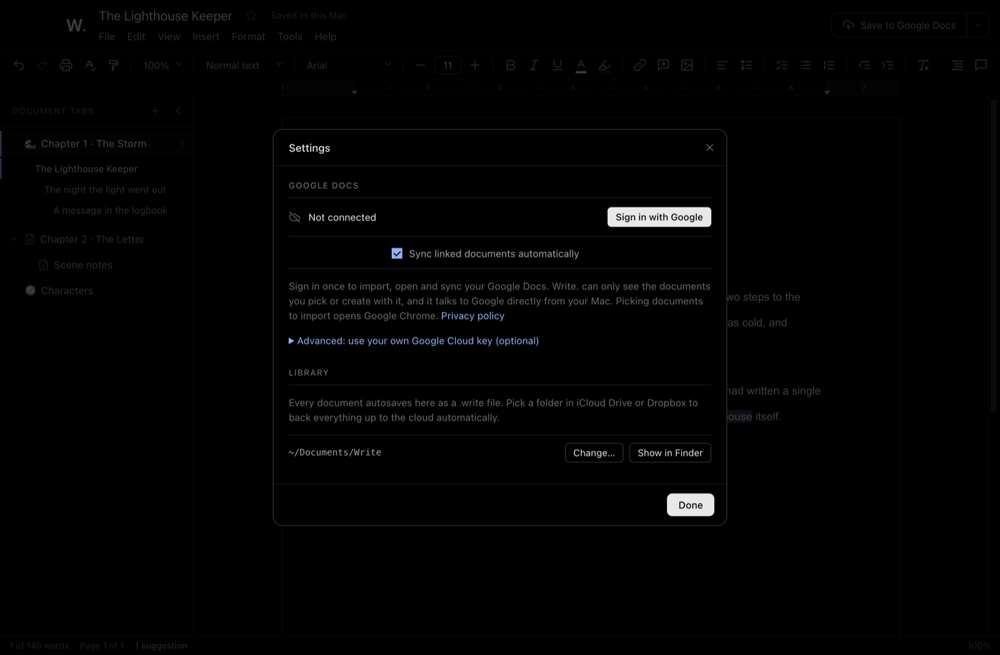

2. Your web browser opens. Choose your Google account and click **Continue**. Return to Write. when the page says *Signed in*.
3. The first time Write. uses your Google sign-in, macOS may ask for your **Keychain** password. Write. keeps your sign-in safe in your Keychain. Type your Mac password and click **Always Allow**.

That's all. No keys, no setup.

### Using sync

- **Bring in Google Docs:** on the home screen, click **Import from Google Docs** (or press **⇧ ⌘ O**). Google's file picker opens in **Google Chrome**. Choose one or more documents and click **Select**. They come into Write. with all their tabs, and they stay linked.
  > Importing needs [Google Chrome](https://www.google.com/chrome/) (or Microsoft Edge), signed in to the same Google account. Google's file picker doesn't work in Safari, because Safari blocks the Google cookies it needs. You can keep using Safari for everything else.
- **Send a document to Google Docs:** in a document, click **Save to Google Docs** at the top right.
- **Automatic sync:** linked documents sync a few seconds after you stop typing. To sync only when you decide, click **⌄** next to the sync button and choose **Pause auto-sync**. Then click **Sync now** whenever you want.
- If a document was changed in both places, Write. asks which version to keep. Nothing is thrown away: older versions stay in version history.

> **Good to know:**
> - Write. can only see the Google Docs you choose or create with it, never the rest of your Drive. It talks to Google directly from your Mac. See the [privacy policy](https://subhodeep2002.github.io/Write/privacy.html).
> - Text, styles, lists and tabs sync both ways. Images and tables come in from Google Docs, but new images and table edits made in Write. stay on your Mac.
> - You can remove Write.'s access at any time in your [Google Account](https://myaccount.google.com/connections).

<details>
<summary>For advanced users: use your own Google Cloud key instead</summary>

Most people don't need this. With your own key, Write. lists all your Google Docs itself instead of using Google's file picker.

1. In the [Google Cloud console](https://console.cloud.google.com/), create a project and enable the **Google Drive API** and the **Google Docs API** (☰ → **APIs & Services → Library**).
2. Open **Google Auth Platform** → **Get started**. Audience: **External**. Then **Audience → Test users → Add users** and add the Gmail address you'll sign in with.
3. Open **Clients → Create client**. Application type: **Desktop app**. Copy the **Client ID** and **Client secret**.
4. In Write., open **Settings**, click **Advanced: use your own Google Cloud key**, paste both, and click **Sign in with Google**. Google says the app isn't verified because it's your own key; click **Continue**.

Keep your Client secret private. While your project is in "Testing" mode, Google asks you to sign in again every 7 days.

</details>

---

## Where are my files?

| What | Where |
| --- | --- |
| Your documents (`.write` files) | **Documents → Write** in your home folder. You can choose a different folder, for example one in iCloud Drive, in **Settings → Library**. |
| Settings and version history | `~/Library/Application Support/Write.` |

Your documents never leave your Mac unless you turn on Google Docs sync.

---

## Updating and uninstalling

**To update:** download the newest `.dmg` from the [Releases page](https://github.com/subhodeep2002/Write/releases). Drag Write. into **Applications** again and choose **Replace**. Your documents and settings are kept. You can check for updates any time from **Help → Check for updates…** in Write.

**To uninstall:** quit Write., then drag **Write** from **Applications** to the **Trash**. Your documents stay in **Documents → Write** until you delete them yourself.

---

## Problems and fixes

| What you see | What to do |
| --- | --- |
| *"Write." can't be opened* or *Apple could not verify…* | Follow [Opening it for the first time](#opening-it-for-the-first-time). |
| *"Write. needs your permission to open this Google Doc"* | Click **Give access**, then select the document in Google's file picker. This can happen once for documents linked with an older version of Write. |
| *"Importing needs Google Chrome"* | Install [Google Chrome](https://www.google.com/chrome/) and sign in to your Google account in it, then click **Import from Google Docs** again. |
| The picker in Chrome says *"Can't access your Google Account"* | Sign in to Chrome with the same Google account you connected in Write. If it still appears, allow third-party cookies for `docs.google.com` in Chrome's settings. |
| *"Access blocked … Error 403"* or *"Turn on the Google Docs API…"* (own key only) | See the advanced steps under [Google Docs sync](#google-docs-sync-optional): add yourself as a test user and enable both APIs. |
| macOS asks for your **Keychain** password | Type your Mac password and click **Always Allow**. |
| The app won't open on an older Mac | Write. needs an Apple Silicon Mac (M1 or newer) with macOS 12 or later. |

---

## Licence and copyright

**Copyright © 2026 Write. (Period), powered by Formula0ne.** All rights reserved.
Releases: **https://github.com/subhodeep2002/Write/releases**

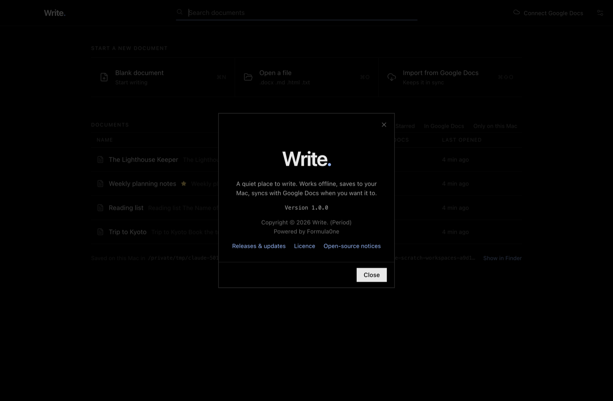

Write. is **free to download and use**. You may share the link to this page, but you may not sell, change or redistribute the app. The source code is private. See [LICENSE](LICENSE) for the full terms.

Write. is built with open-source software, listed in [THIRD_PARTY_NOTICES.md](THIRD_PARTY_NOTICES.md).

Read the [privacy policy](https://subhodeep2002.github.io/Write/privacy.html) and the [terms of use](https://subhodeep2002.github.io/Write/terms.html).

Google Docs and Google Drive are trademarks of Google LLC. Write. is an independent app and is not made by, affiliated with or endorsed by Google.
